## 👋 About

I build things in C, C++, Java, JavaScript and TypeScript, from systems-style projects to web apps.
I like learning in public and shipping small, useful things.

## 🚀 Featured projects

| Project | What it is |
|---|---|
| [Portfolio](https://github.com/aditihehe19/Portfolio) | Personal portfolio (TypeScript) |
| [hash-benchmarker](https://github.com/aditihehe19/hash-benchmarker) | Hash benchmarking tool (TypeScript) |
| [Padhle-AI](https://github.com/aditihehe19/Padhle-AI) | AI study helper (JavaScript) |
| [Student Record Management System](https://github.com/aditihehe19/STUDENT-RECORD-MANAGEMENT-SYSTEM) | C app with 4-tier RBAC and password masking |
| [Circular Queue Simulation](https://github.com/aditihehe19/Queue-Circular-Queue-Simulation-CCC-Project) | Interactive queue visualiser |

## 🐍 Contribution trail

<picture>
  <source media="(prefers-color-scheme: dark)" srcset="https://raw.githubusercontent.com/aditihehe19/aditihehe19/output/github-snake-dark.svg">
  
</picture>

## ♟️ Play the next move

## 📊 Stats

  
  

